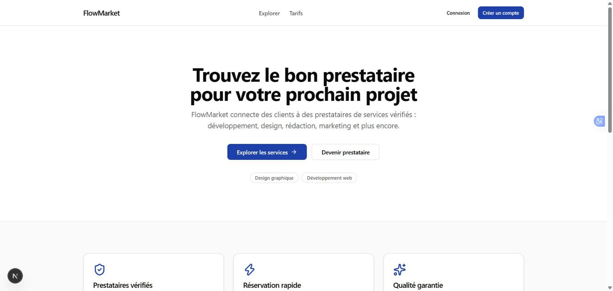
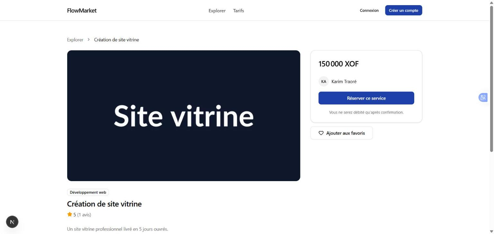
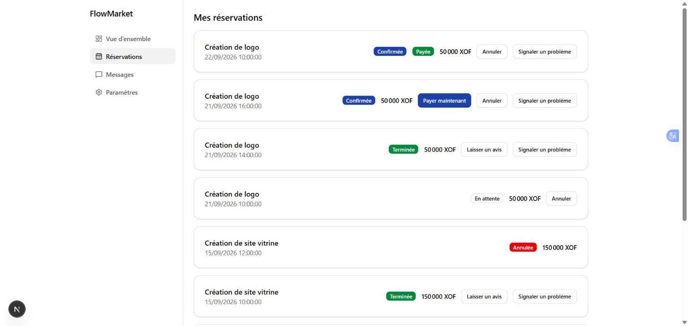
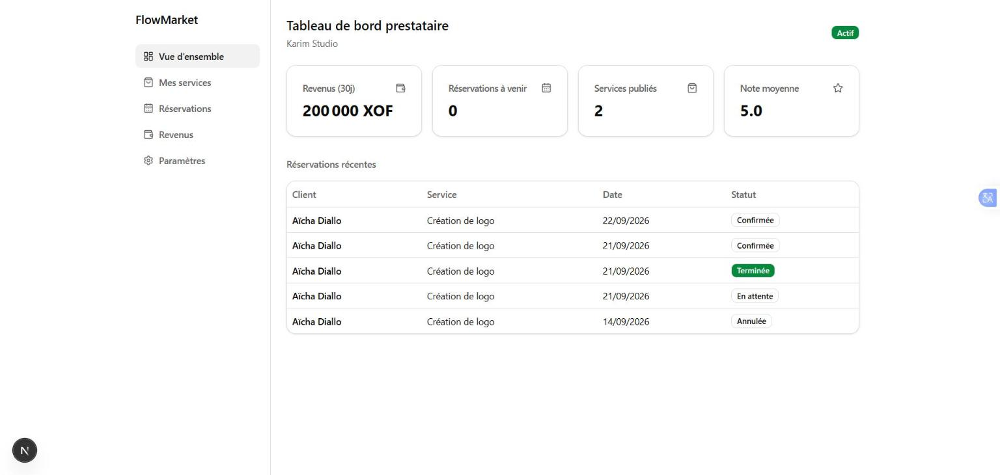
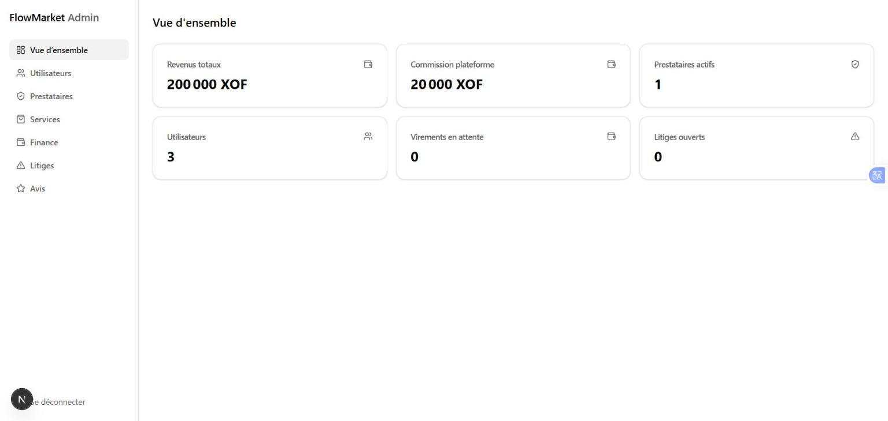
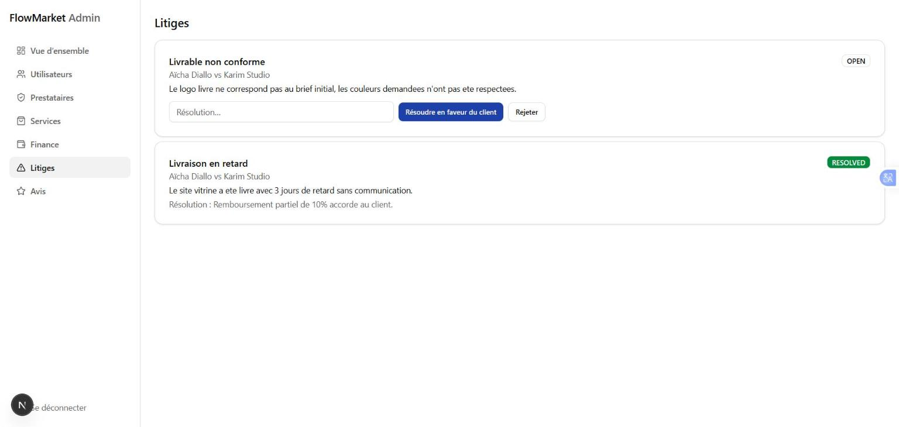

# FlowMarket

FlowMarket est une plateforme SaaS marketplace qui connecte des prestataires
de services (design, développement, conseil, artisanat...) à des clients en
Afrique de l'Ouest. Les prestataires publient leurs offres, gèrent leurs
disponibilités et leurs revenus ; les clients recherchent, réservent et
paient en ligne (carte, Mobile Money) ; une équipe d'administration modère
la plateforme et supervise la finance.

**Auteur / Propriétaire du projet : Enirack**

## Fonctionnalités

### Marketplace client (`apps/web`)

- Recherche et filtrage des services (catégories, prix, note) via
  Meilisearch, pages prestataire et service avec galerie et avis
- Réservation avec gestion des créneaux et détection de conflits
  d'agenda, panier et commande multi-services
- Paiement en ligne multi-provider : Stripe, Flutterwave, CinetPay,
  PayDunya (carte bancaire et Mobile Money), avec mode simulation en
  développement
- Espace client : suivi des réservations, paiement différé, annulation,
  avis après prestation, signalement de litige
- Authentification complète (inscription, connexion, mot de passe oublié,
  vérification d'email)

### Tableau de bord prestataire (`apps/web/provider`)

- Gestion du catalogue de services (création, publication, archivage,
  images)
- Agenda et disponibilités, suivi des réservations entrantes
- Suivi des revenus, solde disponible et demandes de virement

### Back-office administrateur (`apps/admin`)

- Vue d'ensemble : revenus, commissions, utilisateurs actifs, litiges
  ouverts, virements en attente
- Gestion des utilisateurs (suspension / réactivation)
- Vérification des prestataires et dépublication forcée de services
  non conformes
- Modération des avis clients (masquage)
- Résolution des litiges (en faveur du client ou rejet, avec motif)
- Supervision financière : approbation ou rejet des virements
  prestataires

## Captures d'écran

<!-- markdownlint-disable MD033 -->
<table>
  <tr>
    <td width="50%"><br/><sub>Accueil marketplace</sub></td>
    <td width="50%"><br/><sub>Fiche service</sub></td>
  </tr>
  <tr>
    <td width="50%"><br/><sub>Réservations client (avis / litige)</sub></td>
    <td width="50%"><br/><sub>Tableau de bord prestataire</sub></td>
  </tr>
  <tr>
    <td width="50%"><br/><sub>Back-office — vue d'ensemble</sub></td>
    <td width="50%"><br/><sub>Back-office — résolution de litiges</sub></td>
  </tr>
</table>
<!-- markdownlint-enable MD033 -->

## Stack technique

| Domaine         | Technologies                                                       |
| --------------- | ------------------------------------------------------------------ |
| Frontend        | Next.js, React, TypeScript, Tailwind CSS, shadcn/ui, Framer Motion |
| Backend         | NestJS, TypeScript                                                 |
| Base de données | PostgreSQL, Prisma                                                 |
| Infrastructure  | Docker, Docker Compose, Redis                                      |
| Recherche       | Meilisearch                                                        |
| Temps réel      | WebSockets                                                         |
| Tests           | Vitest, Playwright                                                 |
| CI/CD           | GitHub Actions                                                     |

## Architecture

Monorepo géré avec **pnpm workspaces** + **Turborepo**.

```
flowmarket/
├── apps/
│   ├── web/        # Marketplace publique + espaces client/prestataire (Next.js)
│   ├── admin/       # Back-office administrateur (Next.js, app isolée)
│   └── api/          # API centrale REST + WebSocket (NestJS)
├── packages/
│   ├── ui/            # Design system partagé (shadcn/ui personnalisé)
│   ├── database/       # Schéma Prisma, migrations, client généré
│   ├── auth/            # Stratégies d'authentification, guards RBAC
│   ├── payments/         # Abstraction multi-provider de paiement
│   ├── types/             # Types et schémas partagés front/back
│   └── config/             # Configuration TypeScript/ESLint/Prettier partagée
├── docs/                     # Documentation technique
├── tests/                     # Tests end-to-end transverses (Playwright)
└── docker/                     # Fichiers liés à l'infrastructure conteneurisée
```

Le détail des décisions d'architecture est documenté dans [`docs/architecture.md`](./docs/architecture.md).

## Prérequis

- Node.js ≥ 22
- pnpm ≥ 9 (`npm install -g pnpm`)
- Docker + Docker Compose

## Démarrage

```bash
# 1. Installer les dépendances
pnpm install

# 2. Copier les variables d'environnement
cp .env.example .env

# 3. Démarrer l'infrastructure (PostgreSQL, Redis, Meilisearch)
docker compose up -d

# 4. Lancer les applications en développement
pnpm dev
```

## Scripts disponibles

| Commande         | Description                                         |
| ---------------- | ----------------------------------------------------- |
| `pnpm dev`       | Lance toutes les applications en mode développement |
| `pnpm build`     | Build de production de l'ensemble du monorepo       |
| `pnpm lint`      | Lint de l'ensemble du monorepo                      |
| `pnpm typecheck` | Vérification des types TypeScript                   |
| `pnpm test`      | Tests unitaires et d'intégration (Vitest)           |
| `pnpm test:e2e`  | Tests end-to-end (Playwright)                       |
| `pnpm format`    | Formatage du code (Prettier)                        |

## Documentation

- [`docs/architecture.md`](./docs/architecture.md) — architecture générale et décisions
- [`docs/database.md`](./docs/database.md) — modèle de données (ajouté en Phase 2)
- [`docs/api.md`](./docs/api.md) — documentation API (ajouté au fil des phases)
- [`docs/payments.md`](./docs/payments.md) — architecture de paiement (ajouté en Phase 7)
- [`docs/security.md`](./docs/security.md) — pratiques de sécurité (ajouté en Phase 12)
- [`docs/deployment.md`](./docs/deployment.md) — stratégie de déploiement (ajouté en Phase 12)

## Licence

Projet propriétaire — tous droits réservés. Voir [`LICENSE`](./LICENSE).
